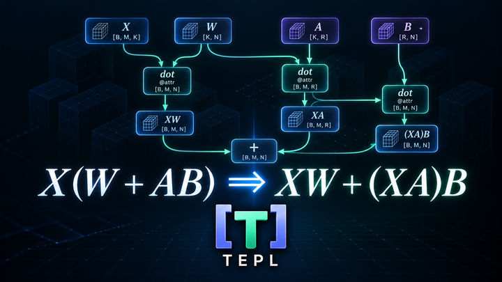

<h1> TEPL - Tensor Equality Pattern Language</h1>

<p align="center">
  
</p>

<p align="center">
  <a href="labs/rust-egg/README.md"></a>
  <a href="docs/tutorial/cpp/01_build.md"></a>
  <a href="https://egraphs-good.github.io/"></a>
  <a href="#-quick-start"></a>
  <a href="LICENSE"></a>
</p>

<p align="center"><strong>TEPL: <em>Write tensor rewrites that read like math.</em></strong></p>

<p align="center"><a href="https://5yearskim.github.io/tepl/">Official Documentation</a></p>

TEPL is a language for tensor rewrite rules with attributes, shape/dtype
contracts, and optional semantic verification. It compiles portable executable
programs, rewrites concrete graphs, and generates Rust/egg or C++20/egg-c code.
Both generated targets use separate shared runtimes.

## A tensor rewrite

With a tensor dialect imported as `t`, compose two transposes:

```tepl
rule compose_transposes {
    (outer: t.transpose (inner: t.transpose X))
    => (t.transpose X)
}
```

The compiler constructs the replacement permutation from source metadata and
checks semantic obligations under the selected arithmetic policy. Conditions and
explicit fields remain part of the rule. See the complete
[example program](examples/rewrite/auto.tepl),
[attribute examples](examples/sample/rules/attributes.tepl), and
[semantic examples](examples/semantic/README.md).

## 🚀 Quick start

Run from the repository root; see the
[build guide](docs/tutorial/rust/01_build.md) for prerequisites.

```sh
bazel build //:tepl
bazel-bin/tepl check examples/sample
bazel-bin/tepl init /tmp/my-tepl-project
```

Compile and execute a concrete rewrite:

```sh
bazel-bin/tepl compile examples/rewrite -o /tmp/program.json
bazel-bin/tepl validate /tmp/program.json
bazel-bin/tepl rewrite /tmp/program.json --trace -o /tmp/result.tepl
```

## Generate an optimizer

```sh
bazel-bin/tepl generate examples/rewrite --out /tmp/rust-app/src/generated
bazel-bin/tepl generate examples/rewrite --target cpp \
  --cpp-namespace my_ir --out /tmp/cpp-app/generated
```

Add the shared runtime to the application. Rust output uses `rustfmt`; C++ uses
`clang-format`. `--no-format` skips formatting; `--check` compares owned output
without changing it. Generated modules contain program-specific code only.

| Target | Integration | Runnable application |
| --- | --- | --- |
| Rust / egg | [Runtime guide](runtime/rust/README.md) | [Transpose example](labs/rust-egg/README.md) |
| C++20 / egg-c | [Runtime guide](runtime/cpp/README.md) | [CMake tutorial](labs/tutorial_cpp/README.md) |

## Find your way

| Goal | Start here |
| --- | --- |
| Learn the language | [Public manual](docs/index.md) and [CLI reference](docs/references/cli.md) |
| Browse runnable TEPL programs | [Examples](examples/README.md) |
| Change compiler/runtime internals | [Implementation design](design/README.md) and [tests](tests/README.md) |
| Read mathematical arguments and drafts | [Research](research/README.md) |
| Reproduce experiments or run integration demos | [Labs](labs/README.md) |
| Build and contribute | [Developer guide](docs/developer_guide.md) |

The TEPL VS Code extension provides syntax highlighting and formatting. Project
roots are marked by `tepl.toml`; start a new project with `tepl init <directory>`.
