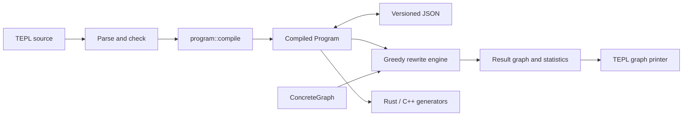

# Compile and run greedy rewrites

TEPL can apply rules directly to a concrete graph and export the result as TEPL
source. Compilation produces a versioned JSON program that the rewrite engine
can load without parsing source, resolving imports, or running attribute
synthesis again.

## Try it

From the repository root:

```sh
bazel build //:tepl
bazel-bin/tepl compile examples/rewrite -o /tmp/program.json
bazel-bin/tepl validate /tmp/program.json
bazel-bin/tepl rewrite /tmp/program.json --trace -o /tmp/result.tepl
bazel-bin/tepl check /tmp/result.tepl
```

This example composes two transposes, removes the resulting identity transpose,
and preserves the shared input of an addition. The result is readable source:

```tepl
// The exporter also emits the dialect import.
graph example {
    input X: f32[2, 3];
    let shared = (d0.add X X);
    yield shared;
}
```

The example is a project with independent dialect, rule, and graph files:

```text
examples/rewrite/
├── dialects/tensor.tepl
├── rules/transpose.tepl
└── graphs/transpose.tepl
```

Graphs and rules each import their dialect. The graph does not import rules;
choose the rule source on the command line:

```sh
bazel-bin/tepl rewrite examples/rewrite/graphs/transpose.tepl \
  --rules examples/rewrite/rules --trace -o /tmp/result.tepl

# Apply only one named rule from the loaded rules.
bazel-bin/tepl rewrite examples/rewrite/graphs/transpose.tepl \
  --rules examples/rewrite/rules --rule compose_transposes --trace
```

`--rules` accepts a file or recursively loads `.tepl` files from a directory in
sorted path order. Each file retains its own imports and aliases. Omitting
`--rule` runs all loaded rules; a missing or ambiguous name reports an error.
Rule selection also works with compiled JSON, whose rules are already stored
in the artifact. All loaded source rules are checked before execution.

You can run the whole project with `tepl rewrite examples/rewrite`; this loads
its `dialects/`, `rules/`, and `graphs/` automatically. Supplying `--rules` with a
project replaces discovery of its default `rules/` directory. A graph directory
such as `examples/rewrite/graphs` can also be paired with `--rules`. Existing
rules declared in graph source files remain loaded.

Use `--graph <name>` when a program contains several graphs. The standalone
`auto.tepl` example at the project root runs a constructor synthesized from axis
semantics; root-level files are excluded from project directory discovery.

## Module boundaries



| Directory | Responsibility |
| --- | --- |
| `src/core/` | Parsing, resolution, checking, semantic verification, and executable lowering. |
| `src/executable/` | Executable program, JSON codec, and validation. |
| `src/shared/` | Types, catalogs, and metadata representations. |
| `schema/` | Public JSON Schema for the compiled format. |
| `src/rewrite/` | Matching, pure expression evaluation, replacement, greedy scheduling, and graph printing. |
| `src/codegen/` | Backend generation from the same compiled program. |

The Bazel target `//src/rewrite` depends on the program loader and shared IR.
Compiler lowering is a separate target, `//src/core/lowering`; the engine does
not depend on the parser or proof search. `ConcreteGraph` is the existing DAG
representation: indexed nodes, operands, concrete attributes, optional shape and
dtype, named bindings, and a root. There is no second graph representation to
keep synchronized.

## Inspect and validate compiled JSON

The format is declared in
[`rewrite-program.schema.json`](../../schema/rewrite-program.schema.json).
Compile [`simple.tepl`](../../examples/rewrite/simple.tepl) to inspect a small
program's JSON output locally.

The envelope contains `format: "tepl.rewrite"`, `version: 2`, an arithmetic
`policy`, required `capabilities`, the `program` tables, and rule-scoped
`axis_definitions`. Rules contain explicit match and replacement trees,
constraints, typed conditions, and descriptor derivations. Expression variants
use `kind` and `data`; references use table IDs. Operation metadata programs
and concrete graphs travel with the rules.

`compile` also accepts `--rules` when compiling graph source separately:

```sh
bazel-bin/tepl compile examples/rewrite/graphs/transpose.tepl \
  --rules examples/rewrite/rules -o /tmp/program.json
```

Compilation resolves `auto` into explicit constructors and retains semantic
proof conditions as executable guards. Unresolved holes and proof search state
are absent from the artifact. Source locations remain for diagnostics and
exported dialect imports; executing the JSON does not read those source files.

Tensor extents and numeric literals use decimal strings to preserve their full
integer range across JSON implementations. IDs are JSON integers bounded by
`2^53 - 1`. Unknown fields, variants, versions, and capabilities are rejected.

```sh
bazel-bin/tepl schema -o /tmp/rewrite-program.schema.json
bazel-bin/tepl validate /tmp/program.json
```

A standard JSON Schema validator checks the document's structure. TEPL also
checks references, scope, operation arity, expression types, and graph topology.
The built-in schema validator implements the vocabulary used by this schema;
it is not a general JSON Schema tool. Loading limits input to 64 MiB and JSON
nesting to 256 levels. Duplicate object keys are rejected.

Validation does not prove that a manually edited rule preserves tensor values.
Numerical correctness depends on the rule and its operation semantics. Source
rules with axis semantics pass through the existing semantic checker before
compilation; ordinary rules retain their existing checking guarantees.

## Greedy execution

Each iteration visits reachable nodes in node-ID order and rules in compiled
order. A candidate must pass structural matching, capture constraints, guards,
derivations, and replacement metadata inference. The first effective replacement
is committed, then scanning restarts. Repeated captures require the same graph
node. Replacing a shared node updates all its uses while preserving unaffected
sharing. Dead operations are removed after replacement; input declarations stay.

Guards and derivations support builtins, local bindings, lists, indexing,
conditionals, comprehensions, descriptor construction, and lowered `auto`
expressions. Logical operators short-circuit. A failed candidate evaluation or
invalid RHS is discarded without changing the graph. Invalid input metadata
reports an error. Operation metadata is inferred from its contracts; serialized
shape/dtype caches are not trusted.

Known output shape and dtype must be preserved. Missing metadata remains
unknown and can prevent a constrained rule from matching. This engine rewrites
graph structure; it does not execute tensor kernels or search for a cheapest
expression. Rule order matters, and opposing rules can cycle.

```sh
bazel-bin/tepl rewrite /tmp/program.json --max-steps 100 --max-nodes 10000
```

The C++ API returns a graph, rewrite count, stop reason, optional trace, and
resource-limit detail:

```cpp
#include "src/executable/program.h"
#include "src/rewrite/engine.h"
#include "src/rewrite/printer.h"

// json_text is an already-read compiled program.
auto program = tepl::executable::load(json_text);
tepl::rewrite::Options options;
options.max_steps = 100;
// options.rule = "compose_transposes";  // Optional rule selection.
options.trace = true;
auto result = tepl::rewrite::run(program, program.ir().graphs.at(0), options);
auto source = tepl::rewrite::printGraph(program.ir(), result.graph);
```

`run` copies its input. Stop reasons are `fixed_point`, `step_limit`,
`resource_limit`, and `cancelled`. Defaults are 1,000 rewrites and 1,000,000 nodes;
temporary RHS nodes count toward the node limit. The API additionally exposes
expression-work and list-size limits, plus a cancellation callback checked
between candidate attempts. A trace records the rule and the node ID before each
committed rewrite, not a stable ID in the final graph.

The CLI writes the TEPL graph to stdout or `-o`, with statistics and trace on
stderr. `--trace` reports each successful application as
`Successfully applied rule '<name>'.` The completion message confirms where the
result was saved or written. Runs stopped by a limit or cancellation are labeled
`Rewrite stopped`.
Exit code `0` means a fixed point, and `3` means execution stopped at a
limit or cancellation with the current graph exported.

## Export and backend limits

The printer emits inputs, explicit attributes, shared `let` bindings, a `yield`,
and absolute dialect imports. Rechecking that source requires the referenced
dialect files. If an artifact's provenance paths are relative, run the exporter
from the original source root or adjust the emitted imports after moving it.
The compiled JSON itself remains executable without those files.

Rust and C++ generators now accept this compiled program, including loaded JSON:

```sh
bazel-bin/tepl compile examples/rewrite/simple.tepl -o /tmp/simple.json
bazel-bin/tepl generate /tmp/simple.json --target rust -o /tmp/generated
```

Their existing supported subset is unchanged. Extended rule expressions,
constructors, and axis semantics execute in the greedy engine; Rust/C++ lowering
for these features remains pending and reports a diagnostic before writing files.

## Changing the format

`tools/build_program_schema.py` contains the explicit field catalog and generates
the schema, codec definitions, and embedded schema. Regenerate them together:

```sh
python3 tools/build_program_schema.py
```

An incompatible format change needs a new version and matching loader behavior.
Tests cover JSON round trips, malformed references, constructors, synthesized
attributes, sharing, metadata failures, limits, source export/reparse, and
agreement between source and JSON execution.
