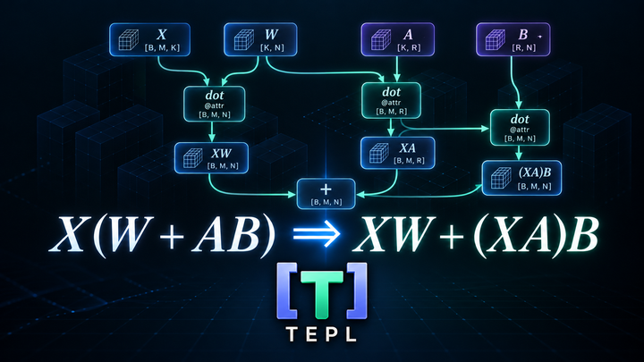
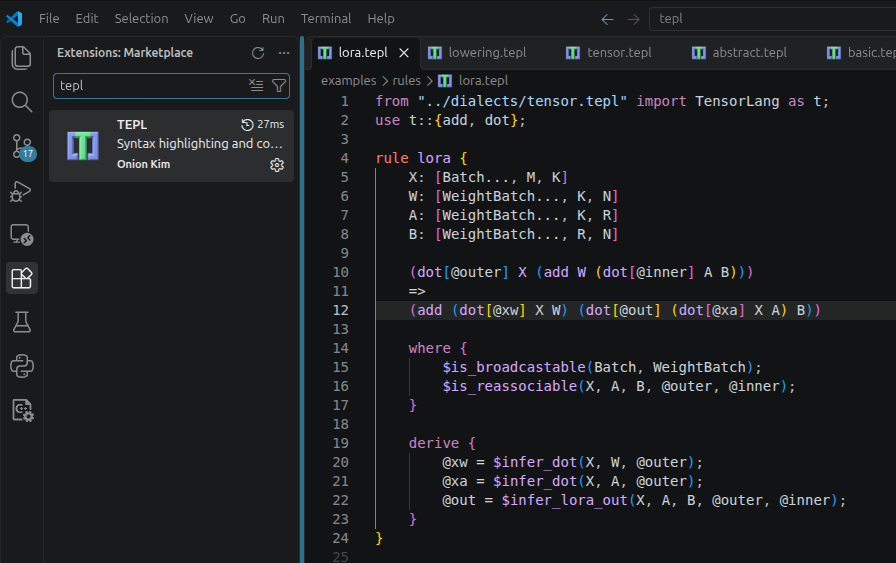

<!-- Keep the layout and content aligned with README.md. Adapt links and images for MkDocs. -->

<h1 class="tepl-home-title"> TEPL - Tensor Equality Pattern Language</h1>

<p align="center">
  
</p>

<div class="tepl-badges" markdown="1">

[](runtime/egraphs/rust/run.md)
[](runtime/egraphs/cpp/setup.md)
[](#quick-start)
[](../LICENSE)

</div>

<p align="center"><strong>TEPL: <em>Write tensor rewrites that read like math.</em></strong></p>

<p align="center"><a href="https://5yearskim.github.io/tepl/">Official Documentation</a></p>

The same tensor computation can be expressed in different ways—with very different costs. In machine learning, choosing the right form can make a big difference: depending on tensor dimensions, `(XA)B` can require far less computation than `X(AB)`.

But turning a mathematical identity into a correct tensor rewrite is hard. The rule needs to capture more than the operations alone: attributes, shapes, dtypes, and numerical semantics all affect whether a transformation is valid.

TEPL is a language dedicated to tensor rewrite rules. It lets you express these details alongside the transformation, rewrite concrete graphs directly, or generate Rust or C++ code for integration into an optimizer.

## 😢 Tensor rewrites need more than symbols

Operation names and nested operands make a rewrite easy to read. For example, composing two transposes looks simple:

```text
(transpose (transpose X))
=>
(transpose X)
```

But which axes does `transpose` permute? Swapping axes `(1, 0)` is different from swapping axes `(2, 1)`. For a rank-three tensor, these swaps correspond to permutations `[1, 0, 2]` and `[0, 2, 1]`, respectively. The symbol `transpose` alone does not tell us which one we mean. The replacement also needs a permutation that combines the two original transposes.

Now consider reassociating matrix multiplication:

```text
(matmul (matmul X A) B)
=>
(matmul X (matmul A B))
```

As humans, we recognize the familiar identity `(XA)B = X(AB)` for compatible matrices under exact arithmetic. But consider what the rewrite engine sees: two `matmul` operations in the pattern and two in the replacement. When represented as general tensor contractions, each operation carries its own attributes, including the contracting dimensions of its left and right operands. Those attributes may need to change after reassociation. Which original operation supplies the attributes for each new one, and which values must be recomputed? This expression does not say.

There is another missing detail: what is `X`? We intend it to be a tensor, but what is its shape or dtype? Many tensor operations need that information to determine whether their inputs are compatible and what shape and dtype their outputs will have. A rewrite also needs to respect numerical semantics, such as whether floating-point reassociation is allowed.

That is why tensor IRs carry more than operation names: attributes and tensor metadata are part of the computation. A tensor rewrite must account for those details too.

> **Operation symbols alone are too abstract to fully describe tensor rewrites. Attributes and shape/dtype transformations must also be explicit.**

## 😭 Writing tensor rewrites by hand is painful

You can write custom matchers and replacement builders to handle attributes, tensor metadata, and legality checks in detail. But the complete pattern and rewrite logic quickly becomes verbose and complex.

For example, here is the same `f32` transpose-composition rule written by hand in Rust using TEPL's shared runtime. This assumes the tutorial dialect's operation types and metadata contracts are already available in a `generated` module.

<details markdown="1">
<summary><strong>👉 See the Rust rewrite</strong></summary>

```rust
use crate::generated::{
    Program, Rewrite,
    dialects::tensor::{Op, TransposeAttrs},
};
use rt::matching::{Constraint, DTypeConstraint, Pattern, ShapeElement};
use rt::values::AttributeValue;
use tepl_runtime::{self as rt, DType, EvalResult, PreparedReplacement, RuleContext};

const X: usize = 0;
const OUTER: usize = 0;
const INNER: usize = 1;

fn transpose_id() -> usize {
    <Program as rt::Program>::operation_id(Op::Transpose.into())
}

fn prepare(ctx: &mut RuleContext<'_, Program>) -> EvalResult<Option<PreparedReplacement<Program>>> {
    // Read both permutations and compute inner[outer[i]].
    let outer = TransposeAttrs::from_value(&ctx.descriptor(OUTER)?)?;
    let inner = TransposeAttrs::from_value(&ctx.descriptor(INNER)?)?;
    let permutation = rt::builtins::call(
        "gather",
        vec![
            rt::values::shape(&inner.permutation),
            rt::values::shape(&outer.permutation),
        ],
        &mut ctx.budget,
    )?;
    let attrs = TransposeAttrs {
        permutation: permutation.dimensions()?,
    };

    // Build the replacement; the runtime checks its metadata before insertion.
    let input = ctx.captured_rhs(X)?;
    Ok(Some(ctx.operation_rhs(
        transpose_id(),
        attrs.to_value(),
        vec![input],
    )?))
}

fn compose_transposes() -> EvalResult<Rewrite> {
    rt::RuleDefinition {
        name: "compose_transposes_explicit",
        source: "manual Rust rule",
        // Match transpose(transpose(X)), binding each descriptor separately.
        lhs: Pattern::Operation {
            operation: transpose_id(),
            descriptor: Some(OUTER),
            operands: vec![Pattern::Operation {
                operation: transpose_id(),
                descriptor: Some(INNER),
                operands: vec![Pattern::Capture(X)],
            }],
        },
        // X must have dtype f32; bind its complete shape as a dimension sequence.
        constraints: vec![Constraint {
            capture: X,
            shape: vec![ShapeElement::Sequence(Some(0))],
            dtype: Some(DTypeConstraint::Exact(DType::F32)),
        }],
        prepare,
    }
    .build()
}
```

</details>

Even a simple rewrite can need separate nested trees for the pattern and replacement, explicit attribute bindings, and metadata checks. As patterns grow, the repeated constructors and bookkeeping make the mathematical rule harder to see, review, and maintain.

## ✨ Write a rule in TEPL, a language dedicated to tensor rewrites

TEPL lets you express the rule, its attributes, and its tensor constraints together. Here is transpose composition with explicit attribute construction, using the [example tensor dialect](../examples/projects/transpose/dialects/tensor.tepl):

```tepl
from "dialects/tensor.tepl" import Tensor as t

rule compose_transposes_explicit {
    X: f32[Dims...]

    (outer: t.transpose (inner: t.transpose X))
    => (result: t.transpose X)

    derive {
        result.attrs = {
            permutation: gather(inner.attrs.permutation, outer.attrs.permutation)
        }
    }
}
```

`outer` and `inner` name the matched operations; `.attrs.permutation` reads their attributes. `gather(p, q)` constructs the composed permutation by selecting `p[q[i]]`. The tensor declaration restricts `X` to an `f32` tensor of any rank. Save this rule under `rules/` in a project with that dialect at `dialects/tensor.tepl`.

With the dialect's axis and value contracts, TEPL can also construct the replacement permutation automatically:

```tepl
rule compose_transposes {
    (t.transpose (t.transpose X)) => (t.transpose X)
}
```

The compiler constructs the eligible axis attributes and checks the transformation under the selected arithmetic policy. You can still supply attributes and conditions explicitly.

TEPL keeps tensor rewrites concise while supporting the features needed for real tensor optimizations:

- **Readable rules:** Write the match and replacement directly, without manually building nested trees.
- **Attribute capture and construction:** Name operations to read their attributes, reuse descriptors with `[source.attrs]`, and compute replacement fields in `derive`.
- **Shape and dtype analysis:** Express tensor constraints such as `f32[Dims...]` and define operation contracts that check inputs and infer outputs.
- **Custom rewrite conditions:** Use `where` to restrict when a rule applies.
- **Semantic verification and axis inference:** Declare operation meaning to verify supported transformations and construct eligible replacement axis attributes.
- **Multiple dialects:** Define and import your own operation dialects, and write rules that rewrite between them.
- **Flexible execution:** Run concrete graph rewrites with TEPL's engine or generate Rust or C++ code for an optimizer.

## 📉 A smaller computation with LoRA

The [LoRA example](../examples/projects/lora/README.md) rewrites a computation with a low-rank adapter. Here, `@` denotes matrix multiplication:

| | Expression |
| --- | --- |
| Before | `X @ (W + A @ B)` |
| After | `X @ W + (X @ A) @ B` |

When the adapter rank is small, reassociation can reduce the arithmetic needed for the adapter branch. The cost of the whole rewrite depends on tensor dimensions and the target.

Read the [TEPL rule](../examples/projects/lora/rules/lora.tepl) or run it from the repository root:

```sh
bazel-bin/tepl rewrite examples/projects/lora --trace -o /tmp/lora.tepl
```

The example selects the `algebraic` policy for distribution and reassociation. This permits ideal-arithmetic laws; it does not promise bit-identical floating-point results.

## 🚀 Quick start

Run from the repository root; see the
[installation guide](getting-started/install.md) for prerequisites and
system-wide installation of the `tepl` command.

```sh
bazel build //:tepl
bazel-bin/tepl check examples/projects/transpose
bazel-bin/tepl init /tmp/my-tepl-project
```

Compile and execute a concrete rewrite:

```sh
bazel-bin/tepl compile examples/projects/transpose -o /tmp/program.json
bazel-bin/tepl validate /tmp/program.json
bazel-bin/tepl rewrite /tmp/program.json --trace -o /tmp/result.tepl
```

Project roots are marked by `tepl.toml`; start a new project with
`tepl init <directory>`. Configure source directories and exclusions under
`[sources]`, and the default semantic policy under `[check]`. See the
[configuration reference](references/cli.md#project-configuration-and-import-paths).

## Generate an optimizer

Generate Rust for egg or C++20 for egg-c from the same TEPL program:

```sh
bazel-bin/tepl generate examples/projects/transpose --out /tmp/rust-app/src/generated
bazel-bin/tepl generate examples/projects/transpose --target cpp \
  --cpp-namespace my_ir --out /tmp/cpp-app/generated
```

Add the shared runtime to the application. Rust output uses `rustfmt`; C++ uses
`clang-format`. `--no-format` skips formatting; `--check` compares owned output
without changing it. Generated modules contain program-specific code only.

| Target | Integration | Runnable application |
| --- | --- | --- |
| Rust / egg | [Runtime guide](../runtime/rust/README.md) | [Transpose example](../labs/rust-egg/README.md) |
| C++20 / egg-c | [Runtime guide](../runtime/cpp/README.md) | [CMake tutorial](../labs/tutorial_cpp/README.md) |

## 💡 Tips

Write rules with less friction: the TEPL extension for VS Code brings syntax
highlighting and code formatting to your editor.

<p align="center">
  
</p>

## 📚 More on…

- [What is TEPL?](getting-started/what-is-tepl.md)
- [Install TEPL](getting-started/install.md)
- [Your first rewrite](getting-started/first-rewrite.md)
- [Design philosophy](design_philosophy.md)
- [Core concepts](language/core-concepts.md)
- [Docs](https://5yearskim.github.io/tepl/)
