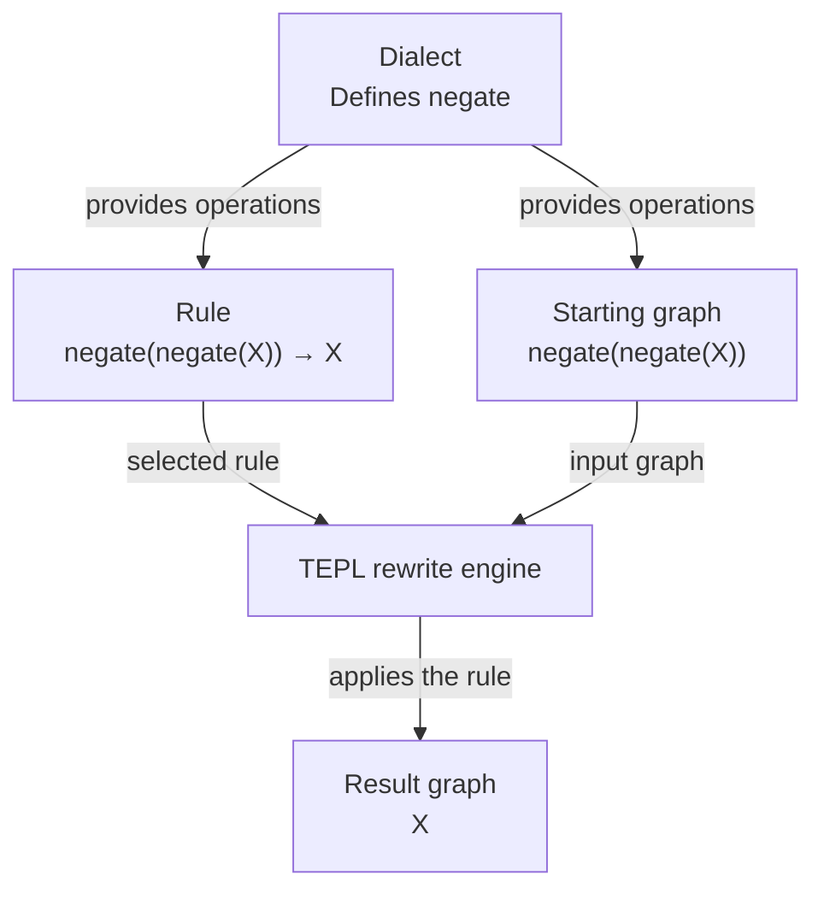

# Dialects, rules, and graphs

A TEPL program has three building blocks:

| Declaration | Describes |
| --- | --- |
| **Dialect** | The operations, their attributes, shapes, and dtypes |
| **Rule** | A pattern and its replacement |
| **Graph** | The concrete computation to transform |

The [basic example](../../examples/basic/double_negation.tepl) puts all three in one file.
It removes two consecutive negations.



The dialect provides the vocabulary for both rules and graphs. The engine
applies the selected rule to the starting graph and returns the rewritten graph.

## Dialect: define the vocabulary

An operation declaration names its operands and result. Optional `dtype` and
`shape` blocks check inputs and calculate output metadata:

```tepl
dialect Basic {
    op negate(input: tensor) -> tensor {
        dtype(t) {
            assert is_float(t)
            yield t
        }
        shape(s) { yield s }
    }
}
```

`negate` accepts one floating-point tensor and preserves its shape and dtype.
The host implements the actual sign reversal.

## Rule: describe a transformation

```tepl
rule cancel_double_negate {
    (Basic.negate (Basic.negate X)) => X
}
```

The operation comes first, followed by its operands. Nesting describes connected
operations. `=>` separates the pattern from the replacement.

`X` matches a tensor value and refers to that same value on the right; it is not
the name of a particular graph input. This rule replaces two negations with the
captured value.

## Graph: supply a computation

```tepl
graph example {
    input X: f32[2, 3]
    let negated = (Basic.negate X)
    yield (Basic.negate negated)
}
```

`input` declares an external tensor. `let` names an intermediate value; reusing
that name shares the value rather than duplicating its computation. `yield`
selects the output.

TEPL uses no semicolons. Keywords, braces, brackets, and parentheses delimit
statements; newlines are whitespace.

## Bring them together

From the repository root, run the complete example:

```sh
bazel-bin/tepl check examples/basic/double_negation.tepl
bazel-bin/tepl rewrite examples/basic/double_negation.tepl --trace -o /tmp/basic-result.tepl
```

The rule removes both negations, leaving a graph that yields `X`.

For larger projects, keep dialects, rules, and graphs in separate files.
An import gives a dialect a short alias, for example:

```tepl
from "dialects/tensor.tepl" import Tensor as t
```

Rules and graphs can then use names such as `t.transpose`. A `tepl.toml` marks the
project root for these imports; graphs import operations and rules are selected
separately.

Next: [shapes and dtypes](tensors.md), then [attributes and conditions](attributes-and-conditions.md).
