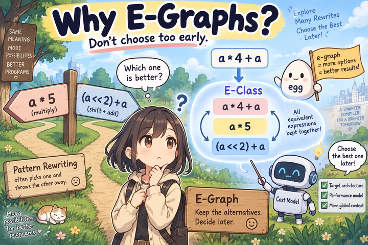

# How e-graphs work

An **e-graph** stores expressions known to be equivalent while sharing their
structure. Rewriting adds alternatives; extraction later chooses one using a
cost model.

## Keep alternatives

Consider the [transpose tutorial](../../getting-started/first-rewrite.md).
Let `T` mean transpose with permutation `[1, 0]` on a matrix. The rules discover:

```text
T(T(X)) = identity_transpose(X) = X
```

The TEPL engine replaces the original graph. An e-graph keeps these forms together:

```text
One e-class for the result:
    X
    identity_transpose(X)
    T(T(X))
```

This is a view of the represented expressions, not three stored expression trees.
An **e-class** groups equivalent expressions. An **e-node** stores an operation,
its attributes, and references to child e-classes. The original expression
remains available after a rewrite adds another form.

A rule's arrow gives the direction of discovery. Once the two sides are united,
they are treated as equal; it does not automatically create a reverse rewrite
that generates new expressions.

## Equality works inside larger expressions

If `T(T(X))` and `X` are equivalent, then so are:

```text
add(T(T(X)), Y)
add(X, Y)
```

This property is **congruence**: applying the same operation, with the same
attributes, to equivalent operands gives equivalent results. E-graph rebuilding
maintains these relationships. For tensor operations, attributes matter: two
transposes with different permutations are not equal just because their operation
names agree.

## Search, then choose

<figure markdown="1">
{ width="720" loading="lazy" }
<figcaption>Keep alternatives, then choose. The illustrated integer identities assume nonnegative values and exact arithmetic.</figcaption>
</figure>

**Equality saturation** repeatedly matches rules, adds replacements, and rebuilds
until no new equalities are found or a resource limit stops search.

An extractor then chooses a low-cost expression from the represented choices.
For the transpose example, a cost that counts operations favors `X`. Other
applications may estimate arithmetic work or target-specific operation costs.

| Stage | Question |
| --- | --- |
| Rewrite validity | Are these computations equivalent under the declared semantics? |
| Search | Which alternatives can the selected rules discover within the limits? |
| Extraction | Which represented alternative has the lowest cost under this model? |

A cost model does not establish correctness. It chooses among alternatives already
treated as equivalent. Limited search does not guarantee a globally optimal result.

## Facts about a shared value

E-class analysis records properties of the value shared by equivalent expressions.
In TEPL's tensor runtimes, these facts include shape and dtype. For our example,
the result class has shape `[2, 3]` and dtype `f32`; the intermediate single
transpose has shape `[3, 2]`.

Analysis can constrain matches and validate replacements. It does not prove that
two arbitrary tensors of the same shape are equal. Equality comes from valid
rules and congruence.

Next: [tensor analysis and rewrite safety](analysis.md), then run generated rules
with [egg in Rust](rust/run.md) or [egg-c in C++](cpp/setup.md).
