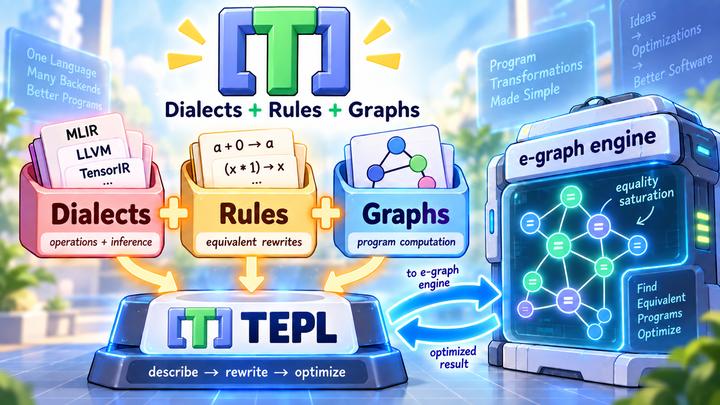

# Runtime integration

Write dialects and rules once, then choose how to apply them.
Both paths use checked rule definitions and replacement metadata validation.

| Runtime | How it rewrites | Application supplies |
| --- | --- | --- |
| **TEPL engine** | Commits replacements to a concrete graph | Rule selection, ordering, and resource limits |
| **E-graph** | Retains equivalent alternatives, then extracts a result | Input metadata, rules, search limits, and a cost model |

## TEPL engine

Use the CLI for direct rewriting, or embed the engine in a C++ application.
Rules run greedily: the first effective replacement is committed, then scanning
restarts. Rule order matters; opposing rules can cycle.

Start with [run rewrites](engine/run.md), then [embed the engine](engine/embed.md).
The engine transforms graphs without executing tensor kernels.

## E-graphs

Use an e-graph when several equivalent forms may be useful before deciding which
to keep. Generate Rust for **egg** or C++20 for **egg-c**. The application runs the
search and chooses an extraction cost model.

<figure markdown="1">
{ width="720" loading="lazy" }
<figcaption>The e-graph integration path: TEPL supplies the operations, rules, and starting graph; the host runs optimization.</figcaption>
</figure>

Start with [how e-graphs work](egraphs/overview.md) and
[tensor analysis and rewrite safety](egraphs/analysis.md).
Then follow [egg in Rust](egraphs/rust/run.md) or [egg-c in C++](egraphs/cpp/setup.md).

## Share a compiled program

`tepl compile` stores checked rules, metadata programs, and graphs in portable
JSON. The TEPL engine can execute it, and both code generators can consume it.
See the [compiled program reference](../references/program-format.md).
