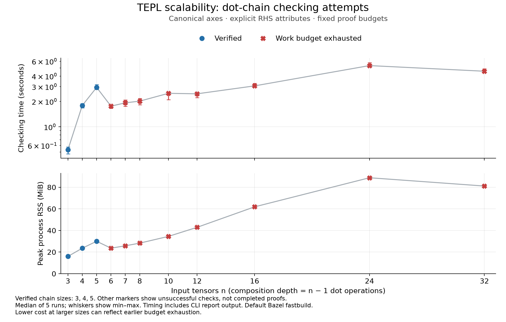

# Canonical dot chain scalability after the axis normalization fix



This graph measures the cost of checking each composite reassociation rule, including unsuccessful attempts. Markers distinguish completed proofs, unresolved obligations, and exhausted budgets. It does not establish successful-proof scalability beyond the verified sizes.

Eleven chain lengths, symbolic positive extents, rank-three inputs, explicit RHS attributes, algebraic policy, one warm-up and five measured runs, fixed budgets, and a 30-second timeout. All generated chains passed independent numerical validation. This run uses the checker after the axis normalization fix; earlier measurements remain separate.

| Input tensors | Outcome | Median time | Median peak RSS |
| ---: | --- | ---: | ---: |
| 3 | proved | 0.534 s | 15.98 MiB |
| 4 | proved | 1.790 s | 23.60 MiB |
| 5 | proved | 2.935 s | 30.02 MiB |
| 6 | budget_exhausted | 1.759 s | 23.64 MiB |
| 7 | budget_exhausted | 1.926 s | 25.82 MiB |
| 8 | budget_exhausted | 2.017 s | 28.29 MiB |
| 10 | budget_exhausted | 2.496 s | 34.53 MiB |
| 12 | budget_exhausted | 2.464 s | 42.95 MiB |
| 16 | budget_exhausted | 3.061 s | 61.89 MiB |
| 24 | budget_exhausted | 5.328 s | 88.82 MiB |
| 32 | budget_exhausted | 4.567 s | 81.15 MiB |

The connecting line tracks all checking attempts. Drops in time or memory can reflect earlier budget exhaustion, rather than improved proof scalability.

[Raw measurements and source hashes](../results/canonical_scaling_axis_fix.json) · [Summary CSV](../results/canonical_scaling_axis_fix_summary.csv) · [SVG figure](canonical_scaling_axis_fix.svg) · [PDF figure](canonical_scaling_axis_fix.pdf)

```sh
python3 lab/reasoning_scalability/scripts/canonical_scaling.py --run-name canonical_scaling_axis_fix --check
python3 lab/reasoning_scalability/scripts/plot_canonical_scaling.py --run-name canonical_scaling_axis_fix
```
