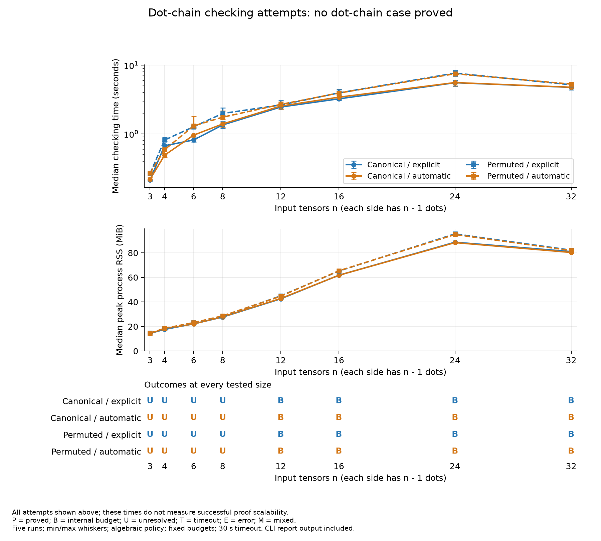
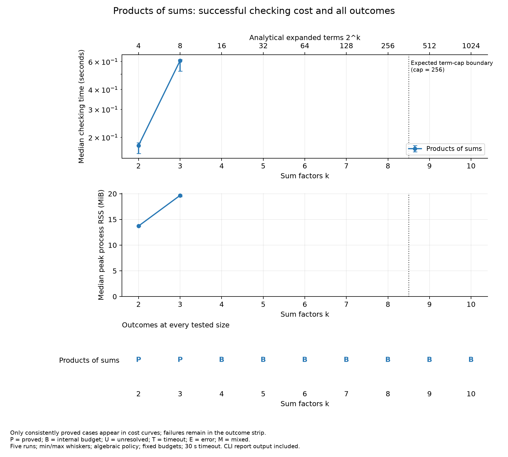

# Reasoning cost and scalability results

The frozen 41-case experiment completed on 2026-10-20 using five measured runs per case, one warm-up, and one diagnostic run. All 287 invocations and input/compiler hashes were validated.

Across the 41 cases, **2 consistently proved**, **23 exhausted an internal budget**, and **16 remained unresolved**. There were 0 consistent timeouts, 0 error cases, and 0 cases with mixed measured outcomes.

The generator's 16 contraction networks and nine product workloads passed independent numerical checks. These checks validate the benchmark construction, not TEPL's semantic proofs.

## Dot chain results

All cases retain symbolic extents and fixed rank-three inputs. Canonical and permuted layouts use the same contraction network; explicit and automatic variants retain identical LHS attributes and conditions.

| Layout | Attributes | Proved / 8 | Largest proved n | First failed n | First failure phase |
| --- | --- | ---: | ---: | ---: | --- |
| canonical | explicit | 0/8 | none | 3 | attribute construction |
| canonical | automatic | 0/8 | none | 3 | attribute construction |
| permuted | explicit | 0/8 | none | 3 | attribute construction |
| permuted | automatic | 0/8 | none | 3 | attribute construction |

**No dot-chain case was proved, including the smallest three-input explicit baselines.** Small cases stop at unestablished shape-equality obligations; larger cases can exhaust the work budget during metadata definedness. This run therefore does not establish successful dot-proof or attribute-inference scalability. No automatic/explicit success-time ratio is defined.

The figure shows the time and memory consumed by checking attempts. Increasing attempt cost is an observation about this checking path; failures can occur before RHS construction or verification.

A flat or falling curve among failures is not improved scalability. A larger rule may exhaust its budget in an earlier phase and return faster than a smaller rule that progresses farther.



Figure adaptation: the plan called for successful-proof cost curves. Because there are no successful dot cases, Figure 1 instead shows all attempt costs and explicitly labels that distinction. The benchmark cases, size grid, conditions, budgets, and repetition count were unchanged.

## Expression expansion results

Source operation count grows linearly with k. The term column is the analytical full expansion, not an observed allocation. Failed checks do not appear on successful-cost curves.



| k | Analytical terms | Outcome | Median time | Time min–max | Median peak RSS | Failure phase |
| ---: | ---: | --- | ---: | ---: | ---: | --- |
| 2 | 4 | proved | 0.178 s | 0.158–0.185 s | 13.72 MiB | — |
| 3 | 8 | proved | 0.609 s | 0.522–0.618 s | 19.68 MiB | — |
| 4 | 16 | budget_exhausted | 2.001 s | 1.931–2.032 s | 33.74 MiB | attribute construction |
| 5 | 32 | budget_exhausted | 3.746 s | 3.624–3.852 s | 83.66 MiB | attribute construction |
| 6 | 64 | budget_exhausted | 4.451 s | 4.243–4.675 s | 89.33 MiB | source lowering |
| 7 | 128 | budget_exhausted | 4.333 s | 4.219–4.471 s | 86.02 MiB | source lowering |
| 8 | 256 | budget_exhausted | 4.395 s | 4.036–4.792 s | 82.63 MiB | source lowering |
| 9 | 512 | budget_exhausted | 4.171 s | 3.798–4.288 s | 79.20 MiB | source lowering |
| 10 | 1024 | budget_exhausted | 3.833 s | 3.611–3.931 s | 73.15 MiB | source lowering |

The largest tested consistently proved expression has **k=3** (8 analytical terms), with median checking time **0.609 s** and median peak RSS **19.68 MiB**.

The first tested failure is **k=4**, classified as `budget_exhausted`. Its diagnostic is: attribute construction: budget exhausted: symbolic proof work limit exceeded. Add an explicit where condition establishing the unresolved requirement, or change the rewrite.

The recorded normalization cap is 256 terms; the first analytical expansion exceeding it is k=9. A general-work or definedness failure at a smaller k must not be described as reaching the normalization term cap. The observed boundary is a boundary of the complete checking pipeline at fixed budgets. This sweep does not isolate exponential normalizer cost when earlier source-lowering or construction work prevents completion.

## Every dot case

Failed-case costs are retained here even though they cannot establish successful proof scaling.

| Layout | Attributes | n | Outcome | Median time | Time min–max | Median peak RSS | Failure phase |
| --- | --- | ---: | --- | ---: | ---: | ---: | --- |
| canonical | explicit | 3 | unresolved | 0.214 s | 0.202–0.219 s | 14.39 MiB | attribute construction |
| canonical | automatic | 3 | unresolved | 0.218 s | 0.210–0.230 s | 14.36 MiB | attribute construction |
| permuted | explicit | 3 | unresolved | 0.265 s | 0.252–0.274 s | 14.62 MiB | attribute construction |
| permuted | automatic | 3 | unresolved | 0.269 s | 0.263–0.272 s | 14.56 MiB | attribute construction |
| canonical | explicit | 4 | unresolved | 0.673 s | 0.644–0.692 s | 17.63 MiB | attribute construction |
| canonical | automatic | 4 | unresolved | 0.490 s | 0.458–0.501 s | 18.16 MiB | attribute construction |
| permuted | explicit | 4 | unresolved | 0.815 s | 0.784–0.895 s | 18.21 MiB | attribute construction |
| permuted | automatic | 4 | unresolved | 0.590 s | 0.517–0.628 s | 18.51 MiB | attribute construction |
| canonical | explicit | 6 | unresolved | 0.816 s | 0.766–0.903 s | 22.15 MiB | attribute construction |
| canonical | automatic | 6 | unresolved | 0.960 s | 0.825–0.985 s | 22.10 MiB | attribute construction |
| permuted | explicit | 6 | unresolved | 1.272 s | 1.239–1.311 s | 23.10 MiB | attribute construction |
| permuted | automatic | 6 | unresolved | 1.309 s | 1.204–1.807 s | 23.14 MiB | attribute construction |
| canonical | explicit | 8 | unresolved | 1.352 s | 1.206–1.509 s | 27.67 MiB | attribute construction |
| canonical | automatic | 8 | unresolved | 1.397 s | 1.241–1.458 s | 27.89 MiB | attribute construction |
| permuted | explicit | 8 | unresolved | 1.987 s | 1.860–2.404 s | 28.30 MiB | attribute construction |
| permuted | automatic | 8 | unresolved | 1.753 s | 1.617–2.158 s | 28.68 MiB | attribute construction |
| canonical | explicit | 12 | budget_exhausted | 2.465 s | 2.307–2.528 s | 42.55 MiB | attribute construction |
| canonical | automatic | 12 | budget_exhausted | 2.544 s | 2.302–2.675 s | 42.83 MiB | attribute construction |
| permuted | explicit | 12 | budget_exhausted | 2.640 s | 2.439–3.056 s | 44.96 MiB | attribute construction |
| permuted | automatic | 12 | budget_exhausted | 2.692 s | 2.513–2.921 s | 44.65 MiB | attribute construction |
| canonical | explicit | 16 | budget_exhausted | 3.244 s | 3.115–3.406 s | 61.78 MiB | attribute construction |
| canonical | automatic | 16 | budget_exhausted | 3.431 s | 3.181–4.427 s | 61.74 MiB | attribute construction |
| permuted | explicit | 16 | budget_exhausted | 3.960 s | 3.654–4.455 s | 65.18 MiB | attribute construction |
| permuted | automatic | 16 | budget_exhausted | 3.939 s | 3.691–4.163 s | 65.40 MiB | attribute construction |
| canonical | explicit | 24 | budget_exhausted | 5.567 s | 4.971–6.029 s | 88.70 MiB | metadata definedness |
| canonical | automatic | 24 | budget_exhausted | 5.599 s | 4.992–5.754 s | 88.38 MiB | metadata definedness |
| permuted | explicit | 24 | budget_exhausted | 7.686 s | 6.967–8.400 s | 95.50 MiB | metadata definedness |
| permuted | automatic | 24 | budget_exhausted | 7.531 s | 7.114–7.815 s | 94.98 MiB | metadata definedness |
| canonical | explicit | 32 | budget_exhausted | 4.769 s | 4.382–5.050 s | 81.06 MiB | source lowering |
| canonical | automatic | 32 | budget_exhausted | 4.787 s | 4.581–5.030 s | 80.36 MiB | source lowering |
| permuted | explicit | 32 | budget_exhausted | 5.204 s | 5.045–5.407 s | 82.23 MiB | source lowering |
| permuted | automatic | 32 | budget_exhausted | 5.317 s | 5.185–5.513 s | 81.90 MiB | source lowering |

## Diagnostics and scope

Diagnostic runs agreed with measured outcomes. Complete compiler output, including each unresolved obligation, is retained in the per-invocation logs. Representative first failures:

- `dot_canonical_explicit_03`: attribute construction: declared conditions and LHS legality do not establish legality obligation: ==(gather(shape(Input(#0)), [0, 2]), gather(shape(Input(#1)), [0, 1])). Add an explicit where condition establishing the unresolved requirement, or change the rewrite.
- `dot_canonical_automatic_03`: attribute construction: declared conditions and LHS legality do not establish legality obligation: ==(gather(shape(Input(#0)), [0, 2]), gather(shape(Input(#1)), [0, 1])). Add an explicit where condition establishing the unresolved requirement, or change the rewrite.
- `dot_permuted_explicit_03`: attribute construction: declared conditions and LHS legality do not establish legality obligation: ==(gather(shape(Input(#0)), [0]), gather(shape(Input(#2)), [1])). Add an explicit where condition establishing the unresolved requirement, or change the rewrite.
- `dot_permuted_automatic_03`: attribute construction: declared conditions and LHS legality do not establish legality obligation: ==(gather(shape(Input(#0)), [0]), gather(shape(Input(#2)), [1])). Add an explicit where condition establishing the unresolved requirement, or change the rewrite.

Each benchmark is one composite rewrite, not repeated application of a local optimization. The study does not establish asymptotic complexity, arbitrary overlapping-axis scalability, floating-point equivalence, or tensor execution speed. Fixed physical layouts also do not demonstrate arbitrary-rank constructor synthesis.

## Measurement environment

- CPU: Intel(R) Core(TM) Ultra 7 155H; 22 logical CPUs; serial benchmark execution.
- Platform: `Linux-7.0.0-38-generic-x86_64-with-glibc2.43`.
- Build: `bazel build //:tepl` using the existing default Bazel configuration (`k8-fastbuild`); this is not a release-optimized performance run.
- Revision: `214f7d0abcb4bb8b88f7f022b89ec28f4cab634b` with the recorded working-tree changes and per-file hashes.
- Compiler SHA-256: `132206b71f83883c9271c600c2d2c00276ef7966991a15aaf0e18b5a243c89c0`.
- Start load averages: [0.63037109375, 0.52294921875, 0.56982421875].
- One warm-up and five measured fresh processes per case; deterministic shuffled order; 30 s timeout.
- Peak RSS comes from GNU time for each compiler child; median and min/max summarize repetitions.
- Timing includes parsing, reasoning, report serialization, redirected output, and wrapper overhead. The current CLI does not provide a quiet semantic-report mode.
- No proof limits or compiler implementation were changed for this experiment.

Recorded proof limits:

```json
{
  "expression_depth": 256,
  "evidence_depth": 64,
  "query_depth": 24,
  "query_work": 2048,
  "normalization_terms": 256,
  "extent_bound_steps": 8,
  "general_inference_work": 100000
}
```

## Reproduction and saved evidence

See [the plan](../README.md) for generation and measurement commands. Run analysis with NumPy and Matplotlib:

```sh
# In a Python environment containing requirements.txt dependencies:
python3 lab/reasoning_scalability/scripts/benchmark.py --check
python3 lab/reasoning_scalability/scripts/analyze.py
```

- [Frozen cases and validation manifest](../inputs/manifest.json)
- [Raw run records and source provenance](../results/run.json)
- [Case summary JSON](../results/summary.json)
- [Case summary CSV](../results/summary.csv)
- [All invocation records as CSV](../results/invocations.csv)
- [Analysis package versions and script hash](../results/analysis_environment.json)
- [Measured stdout and stderr logs](../results/logs/measured/)
- Figures are provided as PNG, SVG, and PDF beside this report.

The 41 input rules were not strengthened or filtered after the preflight failures. Preflight logs are retained separately and excluded from all measured summaries.
