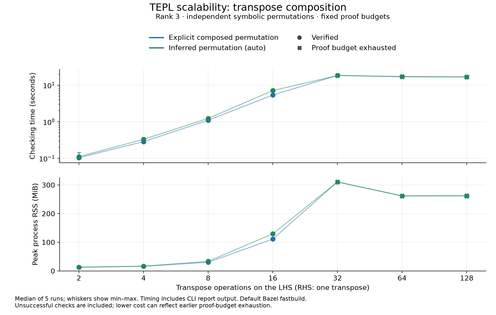

# Transpose-chain scalability

Each rule collapses a chain of n transposes to one transpose. The LHS has independent symbolic permutation attributes at every stage. Inputs have rank three with symbolic positive extents. The explicit RHS uses the derived composition of all n permutations; the auto RHS asks TEPL to infer that permutation. Each whole rule is checked independently.

The algebraic policy, default proof budgets (1,000,000 work units per synthesis/verification context), compiler, and timing method match the corrected dot-chain experiment. There is one warm-up and five measured fresh-process invocations per case, with a 30-second timeout. Transpose values do not add reductions or arithmetic expansion.

The generator passed 148 independent dense checks, including every pair of rank-three permutations and random longer compositions.

| Transposes | RHS attributes | Outcome | Median time | Median peak RSS |
| ---: | --- | --- | ---: | ---: |
| 2 | explicit | proved | 0.104 s | 12.88 MiB |
| 2 | automatic | proved | 0.111 s | 12.92 MiB |
| 4 | explicit | proved | 0.286 s | 16.04 MiB |
| 4 | automatic | proved | 0.331 s | 16.47 MiB |
| 8 | explicit | proved | 1.098 s | 30.09 MiB |
| 8 | automatic | proved | 1.234 s | 33.41 MiB |
| 16 | explicit | proved | 5.368 s | 111.12 MiB |
| 16 | automatic | proved | 7.106 s | 129.51 MiB |
| 32 | explicit | budget_exhausted | 18.413 s | 310.59 MiB |
| 32 | automatic | budget_exhausted | 18.320 s | 310.61 MiB |
| 64 | explicit | budget_exhausted | 16.858 s | 261.73 MiB |
| 64 | automatic | budget_exhausted | 17.225 s | 261.57 MiB |
| 128 | explicit | budget_exhausted | 16.758 s | 262.70 MiB |
| 128 | automatic | budget_exhausted | 16.731 s | 261.85 MiB |

Verified sampled lengths:
- explicit: 2, 4, 8, 16.
- automatic: 2, 4, 8, 16.

The sampled lengths do not establish the exact boundary between them. These results characterize rank-three symbolic permutation composition, not arbitrary tensor graphs. Failed checks are retained in the figure and are not completed proofs.

[Raw records and source hashes](../results/transpose_scaling.json) · [Summary CSV](../results/transpose_scaling_summary.csv) · [SVG](transpose_scaling.svg) · [PDF](transpose_scaling.pdf)

Validation: python3 lab/reasoning_scalability/scripts/transpose_scaling.py --check
