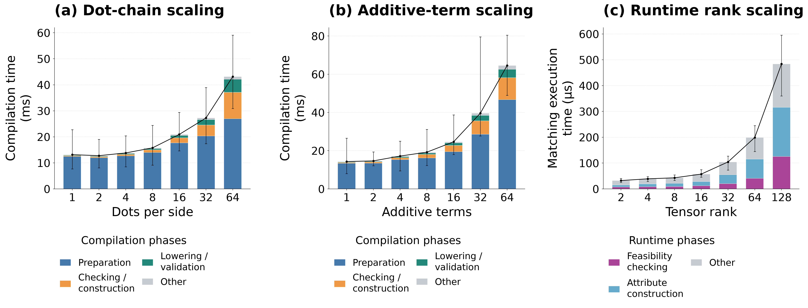

# Recorded artifact results

| Measurement | Result |
|---|---|
| Modeled XLA coverage | 98/123 accepted |
| XLA axis inference | 31/38 accepted |
| Einsum | 226 verified rewrites; 15,928 inferred axis entries |
| Source size, 30 matched rules | 10,022 / 3,205 / 2,374 tokens |

Source-size totals for all 31 TEPL cases are recorded separately in the JSON. Current validation outcomes for explicit and inferred source forms remain in the raw run.

The JSON records evidence hashes and compiler provenance. Whole-pass XLA integration and the four-workload experiment are not measured by these compiler results.

The two-rule transpose integration passed 28 pass-level graph comparisons and 84 numerical input sets.

Largest successful dots per side: 64; mean total 43.2 ms.

Largest successful additive terms: 64; mean total 64.6 ms.

Largest successful tensor rank: 128; mean total 483.8 µs.

Panel c, size 256 excluded: rank_256: metadata work limit.

