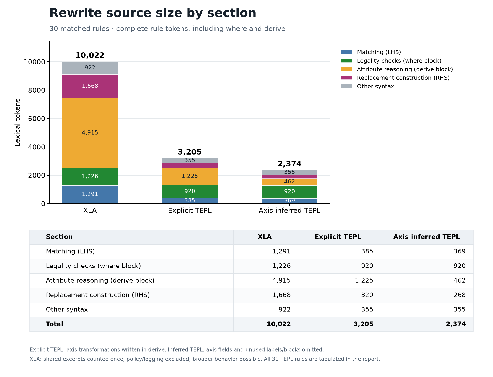

# XLA, explicit TEPL, and axis inferred TEPL by source section

The graph uses **30 matched rules** from the 31 successful synthesis cases. The additional `catalog_dot_scalar_multipliers` rule has no corresponding XLA dot implementation in the pinned snapshot and appears only in the separate **31-rule TEPL table** below. Explicit TEPL spells out the RHS axis transformations in `derive`. Axis inferred TEPL omits inferable axis fields, removes unused node labels, and removes empty assignments/derive blocks. Supplied non-axis attributes and their required labels/helpers remain. Both use the same normalized graph and `where` conditions (including the successful broadcast–transpose companion).

## Thirty-rule comparison

| Section | XLA | Explicit TEPL | Axis inferred TEPL |
|---|---:|---:|---:|
| Matching (LHS) | 1,291 | 385 | 369 |
| Legality checks (where block) | 1,226 | 920 | 920 |
| Attribute reasoning (derive block) | 4,915 | 1,225 | 462 |
| Replacement construction (RHS) | 1,668 | 320 | 268 |
| Other syntax | 922 | 355 | 355 |
| **Total** | **10,022** | **3,205** | **2,374** |

## All 31 successful cases: TEPL source sizes

| Section | Explicit TEPL | Axis inferred TEPL |
|---|---:|---:|
| Matching (LHS) | 407 | 391 |
| Legality checks (where block) | 981 | 981 |
| Attribute reasoning (derive block) | 1,285 | 479 |
| Replacement construction (RHS) | 342 | 288 |
| Other syntax | 381 | 381 |
| **Total** | **3,396** | **2,520** |

## Counting rules

TEPL rows follow literal source sections: complete LHS, complete `where` block, complete `derive` block, complete RHS, and all remaining rule tokens. Block keywords/braces and all local computations are included. Inline descriptors stay with their containing graph; tensor shape/type declarations, the arrow, and outer rule syntax are in **Other syntax**. No token is counted twice. Imports/use declarations and shared dialect implementations are outside whole-rule totals; comments and whitespace count zero. These are lexical tokens, not LLM tokens.

XLA has no LHS/where/derive/RHS blocks. Its selected source lines are assigned the corresponding responsibilities by inspection: matching, legality, attribute computations, replacement construction, and other code (including graph management). Control syntax follows the dominant responsibility of its source line. Shared excerpts/helpers are counted once across rules. Policy (1,380 tokens) and logging (107 tokens) are recorded separately and excluded.

## Interpretation and evidence

A fresh check of the measured representations accepts **31/31 compact inferred rules** and **28/31 explicit rules** through proof, compilation, and JSON validation. Explicit rules with unresolved proofs remain countable source and are included, with diagnostics in the verification JSON. Explicit fields are restored from handwritten transformations after the same unit-view normalization; the companion uses its existing local `d` as its explicit broadcast mapping. Omission, label removal, and empty-block removal all contribute to the measured reduction. XLA often handles more ranks and operand orders; equal case counts do not establish equal behavioral breadth. The annotations have one analyst's review and no independent review.

[SVG graph](section_comparison.svg), [LaTeX tables](section_comparison.tex), [measurements and source snapshots](../results/section_comparison.json), [new representation verification](../results/section_verification.json), [annotated XLA excerpts](section_xla_excerpts.txt), [source annotation ledger](../data/xla_spans.json), and [protocol](../protocol.md).

Recorded synthesis run UTC: `2026-10-29T21:49:30.161183+00:00`. Original evaluation compiler SHA-256: `a647eb68c4de993dc4e77b79c69382b4f69de4905b90b7447901e3e30770d87e`. Representation verification UTC: `2026-11-04T19:32:54.484604+00:00`; compiler SHA-256: `f6437fc7366aa5a45272305466a5172b2fc548ef55956459da26932315ae5055`. Frozen evaluation results remain unchanged.
